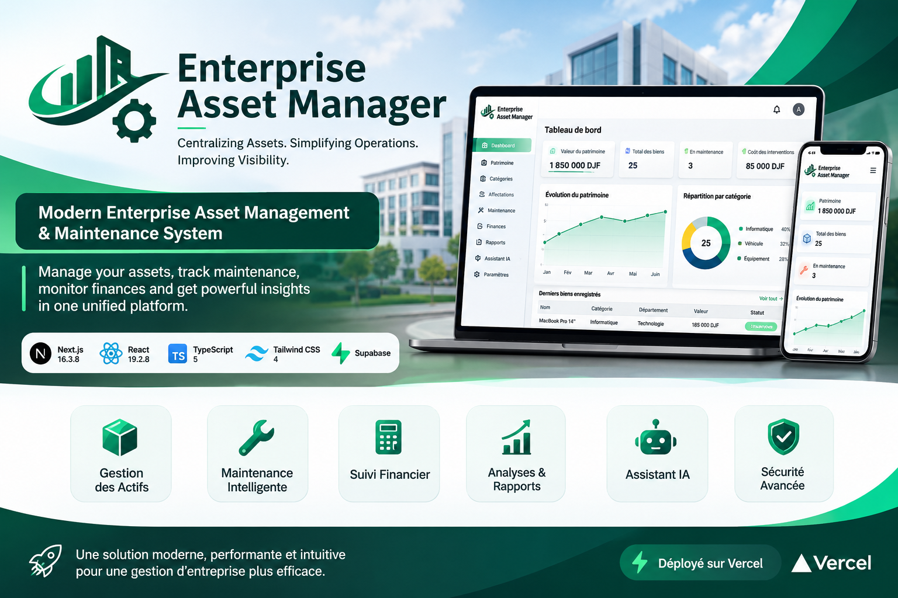
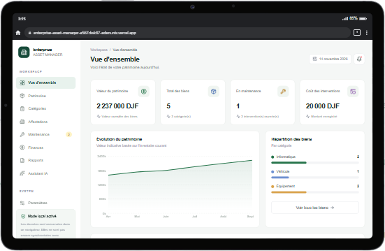
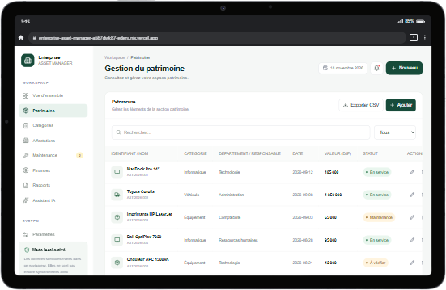
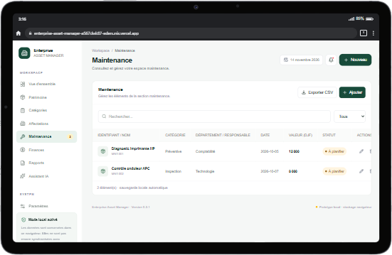
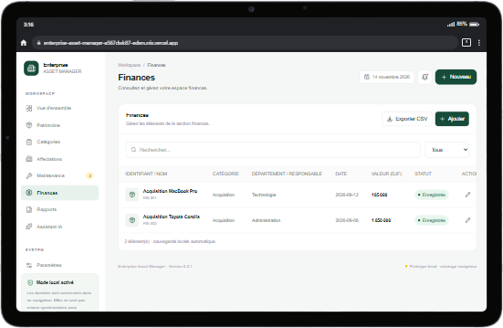

# 🏢 Enterprise Asset Manager — Enterprise Asset & Maintenance Management System

[](https://github.com/edenunix/enterprise-asset-manager)
[](https://nextjs.org/)
[](https://react.dev/)
[](https://www.typescriptlang.org/)
[](https://tailwindcss.com/)
[](https://supabase.com/)
[](https://recharts.org/)
[](https://vercel.com/)

> **Modern Enterprise Asset Management Platform**
>
> A web-based management application designed to centralize organizational assets, equipment, maintenance activities, financial records and operational reporting through a unified dashboard.
>
> **Live Application:** https://enterprise-asset-manager-nine.vercel.app/

---

<p align="center">
  
</p>

01 — Dashboard



02 — Asset Management



03 — Maintenance Management



04 — Financial Management & Reports


## 📑 Table of Contents

- [1. Project Overview](#1-project-overview)
- [2. Objectives & Vision](#2-objectives--vision)
- [3. Technology Stack](#3-technology-stack)
- [4. Application Architecture](#4-application-architecture)
- [5. Modules & Core Features](#5-modules--core-features)
- [6. Dashboard & Analytics](#6-dashboard--analytics)
- [7. Asset Management](#7-asset-management)
- [8. Maintenance Management](#8-maintenance-management)
- [9. Financial Management](#9-financial-management)
- [10. Reporting & Data Export](#10-reporting--data-export)
- [11. AI Assistant Integration](#11-ai-assistant-integration)
- [12. Data Storage & Persistence](#12-data-storage--persistence)
- [13. User Interface & Design](#13-user-interface--design)
- [14. Installation & Local Development](#14-installation--local-development)
- [15. Available Scripts](#15-available-scripts)
- [16. Deployment](#16-deployment)
- [17. Current Technical Scope](#17-current-technical-scope)
- [18. Future Development](#18-future-development)
- [19. Repository](#19-repository)

---

## 1. Project Overview

**Enterprise Asset Manager** is a modern web application dedicated to enterprise asset management and operational monitoring.

The platform provides a centralized interface for organizing physical assets, tracking equipment status, managing maintenance activities, monitoring financial transactions and generating operational reports.

It is designed to provide organizations with a clearer overview of their resources and simplify everyday administrative operations.

The application brings together several management areas within a single workspace:

- Enterprise asset inventory.
- Asset categorization.
- Department and responsibility tracking.
- Equipment assignments.
- Maintenance monitoring.
- Financial transaction records.
- Operational dashboards and analytics.
- CSV reporting and data exports.
- AI-assisted inventory analysis.

**Project Identity**

| Attribute | Information |
|---|---|
| Project Name | Enterprise Asset Manager |
| Repository | `edenunix/enterprise-asset-manager` |
| Application Type | Web Application |
| Frontend Framework | Next.js |
| Programming Language | TypeScript |
| UI Library | React |
| Database Integration Dependencies | Supabase |
| Currency | DJF – Djiboutian Franc |
| Deployment Platform | Vercel |

---

## 2. Objectives & Vision

The main objective is to provide a unified management environment for enterprise assets and associated operational activities.

### Strategic Objectives

1. **Centralized Asset Inventory:** Organize equipment and organizational resources in a structured inventory.

2. **Asset Lifecycle Visibility:** Monitor the operational status and recorded value of organizational assets.

3. **Maintenance Monitoring:** Track maintenance interventions, inspection activities and associated costs.

4. **Departmental Organization:** Associate assets and operational records with departments and responsible parties.

5. **Financial Transparency:** Maintain records of acquisitions, expenses and other financial transactions in DJF.

6. **Operational Analytics:** Present key management indicators through dashboards and graphical visualizations.

7. **Data Accessibility:** Enable users to retrieve and export management information in CSV format.

8. **Intelligent Assistance:** Provide an AI assistant interface for natural-language questions about the asset inventory.

---

## 3. Technology Stack

The application is built using a modern JavaScript and TypeScript ecosystem.

| Technology | Version | Purpose |
|---|---|---|
| Next.js | 16.3.8 | Application framework |
| React | 19.2.8 | User interface |
| TypeScript | 5.x | Static typing |
| Tailwind CSS | 4.x | Styling and responsive design |
| Lucide React | 1.x | Interface icons |
| Recharts | 3.x | Data visualization |
| Supabase JS | 2.x | Backend and database integration dependency |
| Supabase SSR | 0.12.x | Supabase server-side integration dependency |
| Google Generative AI | 0.21.x | Gemini AI SDK |
| ESLint | 9.x | Code quality and linting |
| Vercel | — | Application hosting |

### Frontend Architecture

- Next.js App Router.
- React Client Components.
- TypeScript interfaces and typed data structures.
- Tailwind CSS utility classes.
- Responsive dashboard layout.
- Browser-based state management.
- Local browser persistence.

### Visualization

Recharts is used to display asset valuation trends and graphical summaries.

### Icons

Lucide React provides consistent visual representations for assets, vehicles, equipment, maintenance and administrative operations.

---

## 4. Application Architecture

The project follows a Next.js application structure with a client-side management dashboard.

### High-Level Architecture

```text
ENTERPRISE-ASSET-MANAGER/
│
├── public/
│   └── Static public assets
│
├── src/
│   └── app/
│       ├── page.tsx
│       │   └── Main management dashboard
│       │
│       ├── globals.css
│       │   └── Global styles and responsive layout
│       │
│       └── layout.tsx
│           └── Root application layout
│
├── .gitignore
├── AGENTS.md
├── CLAUDE.md
├── eslint.config.mjs
├── next.config.ts
├── package.json
├── package-lock.json
├── postcss.config.mjs
├── tsconfig.json
└── README.md
```

*The structure above describes the main repository organization and application files.*

### Application Data Model

The current application organizes records using a shared TypeScript data structure.

Each management record contains:

| Field | Description |
|---|---|
| `id` | Unique record identifier |
| `name` | Asset or record name |
| `category` | Classification or transaction type |
| `department` | Associated department or responsible party |
| `date` | Record date |
| `value` | Monetary value or recorded cost |
| `status` | Current operational status |

### Record Identification

The application uses structured identifiers with different prefixes:

| Prefix | Management Area |
|---|---|
| `AST` | Assets |
| `CAT` | Categories |
| `AFF` | Assignments |
| `MNT` | Maintenance |
| `FIN` | Financial records |

---

## 5. Modules & Core Features

The application provides eight principal management areas and a dedicated settings section.

| Module | Main Responsibilities |
|---|---|
| Dashboard | Overview of organizational assets and indicators |
| Patrimoine | Asset inventory and asset records |
| Catégories | Asset classification |
| Affectations | Assignment records |
| Maintenance | Maintenance interventions and inspections |
| Finances | Financial transaction records |
| Rapports | Reporting and CSV exports |
| Assistant IA | AI-assisted inventory questions |
| Paramètres | Workspace administration settings |

### 5.1 Asset Inventory Management

The asset management module centralizes organizational equipment and property records.

Features include:

- Registering new assets.
- Editing existing records.
- Removing obsolete records.
- Assigning categories.
- Associating assets with departments.
- Recording acquisition or registration dates.
- Tracking asset values in DJF.
- Monitoring operational statuses.
- Searching and filtering inventory records.

### 5.2 Category Management

The category module organizes assets according to their type.

Examples included in the demonstration data:

- Informatique.
- Véhicule.
- Équipement.
- Mobilier.

Categories can be registered, modified and removed through the management interface.

### 5.3 Assignment Management

The assignments module provides a dedicated section for organizing assignment records.

Records can contain:

- Assignment identifier.
- Associated item or resource name.
- Category.
- Department or responsible party.
- Date.
- Recorded value.
- Assignment status.

### 5.4 Maintenance Management

The maintenance module provides an overview of recorded maintenance activities.

Supported record information includes:

- Intervention identification.
- Equipment or intervention name.
- Maintenance category.
- Responsible department.
- Scheduled or recorded date.
- Associated maintenance cost.
- Intervention status.

Example maintenance statuses:

- À planifier.
- En cours.
- À vérifier.
- Terminée.

### 5.5 Financial Management

The financial module centralizes financial records associated with organizational assets.

Examples of recorded transaction categories include:

- Acquisitions.
- Expenses.
- Other financial records.

Each record includes a name, category, department, date, amount and status.

---

## 6. Dashboard & Analytics

The dashboard provides an immediate overview of the organization's recorded assets and maintenance activities.

### Key Performance Indicators

The main dashboard displays four indicators:

| Indicator | Description |
|---|---|
| Valeur du patrimoine | Total recorded value of organizational assets |
| Total des biens | Number of registered assets |
| En maintenance | Number of assets with maintenance status |
| Coût des interventions | Total recorded maintenance costs |

### Graphical Analytics

**1. Asset Valuation Trend**

An area chart displays an indicative evolution of the recorded asset value.

**2. Asset Distribution**

A category-based visualization displays the number and percentage of assets belonging to each category.

**3. Latest Registered Assets**

A table presents the latest asset records, including identifiers, categories, departments, values and statuses.

### Dashboard Features

- Dynamic KPI calculations.
- Category-based distribution.
- Maintenance indicators.
- Asset valuation visualization.
- Latest inventory records.
- Notification panel for outstanding maintenance activities.

---

## 7. Asset Management

Asset records are organized using a structured inventory model.

### Asset Information

Each asset can contain:

- Asset identifier.
- Name and description through its name field.
- Category.
- Department.
- Registration date.
- Monetary value.
- Operational status.

### Supported Operations

| Operation | Description |
|---|---|
| Create | Register a new asset |
| Read | Display asset records |
| Update | Modify existing information |
| Delete | Remove an existing record |
| Search | Find records using text |
| Filter | Filter records by status |
| Export | Download records in CSV format |

### Asset Status Examples

- En service.
- Maintenance.
- À vérifier.

### Demonstration Inventory

The application includes sample records such as:

| Asset | Category | Department | Value |
|---|---|---|---:|
| MacBook Pro 14″ | Informatique | Technologie | 185,000 DJF |
| Toyota Corolla | Véhicule | Administration | 1,850,000 DJF |
| HP LaserJet Printer | Équipement | Comptabilité | 65,000 DJF |
| Dell OptiPlex 7020 | Informatique | Ressources humaines | 95,000 DJF |
| APC 1500VA UPS | Équipement | Technologie | 42,000 DJF |

*These are demonstration records, not verified real-world organizational assets.*

---

## 8. Maintenance Management

Maintenance monitoring provides a dedicated space for recording equipment interventions.

### Main Capabilities

- Register maintenance interventions.
- Classify maintenance activities.
- Associate activities with departments.
- Record intervention costs.
- Track maintenance status.
- Display outstanding intervention counts.
- Monitor total recorded maintenance expenses.

### Example Maintenance Records

| Intervention | Type | Department | Cost |
|---|---|---|---:|
| HP Printer Diagnostic | Préventive | Comptabilité | 12,000 DJF |
| APC UPS Inspection | Inspection | Technologie | 8,000 DJF |

The dashboard calculates the number of outstanding maintenance records and their total recorded cost.

---

## 9. Financial Management

Financial records provide visibility into the monetary information associated with organizational resources.

### Main Capabilities

- Record asset acquisitions.
- Register financial transactions.
- Associate transactions with departments.
- Record transaction dates.
- Track transaction amounts.
- Monitor financial record statuses.

### Currency Standard

The application uses:

**DJF — Franc Djibouti**

Monetary values are formatted using French number formatting.

Example:

```text
1850000 DJF
```

Displayed as:

```text
1 850 000 DJF
```

---

## 10. Reporting & Data Export

The reporting module provides direct access to downloadable management records.

### Available Reports

| Report | Information |
|---|---|
| Inventaire du patrimoine | Asset inventory and total recorded value |
| Maintenance | Recorded maintenance interventions |
| Finances | Financial transactions |

### CSV Export

The application supports CSV exports with the following columns:

```text
Identifiant
Nom
Catégorie
Département / responsable
Date
Valeur (DJF)
Statut
```

### Export Characteristics

- CSV file generation.
- UTF-8 encoding.
- UTF-8 BOM for spreadsheet compatibility.
- Semicolon-separated fields.
- Automatic filename generation based on the selected section and current date.

Example filename:

```text
patrimoine-2026-11-14.csv
```

---

## 11. AI Assistant Integration

The application includes a dedicated AI assistant interface designed to support natural-language questions about organizational assets.

### Assistant Capabilities

The interface allows users to submit questions about their inventory.

Example questions:

- Which asset has the highest recorded value?
- Summarize the current state of the IT equipment.
- Analyze the recorded asset inventory.
- Provide an overview of organizational resources.

### Integration Architecture

The frontend uses the Google Generative AI SDK as a project dependency and sends assistant requests through the following application endpoint:

```http
POST /api/assistant
```

The request includes:

```json
{
  "prompt": "Which asset has the highest recorded value?",
  "patrimoine": []
}
```

The interface expects a JSON response containing a `result` or an `error` field.

**Implementation note:** The assistant interface is present in the frontend. The backend endpoint implementation and its complete configuration should be verified separately before considering the AI integration operational.

---

## 12. Data Storage & Persistence

The current application uses browser-based storage to preserve management records.

### Local Storage

The principal storage key is:

```text
enterprise-asset-manager-v1
```

The administrator display name is stored separately:

```text
eam-admin-name
```

### Persistence Workflow

```text
User Interaction
       |
       v
React Application State
       |
       v
Management Records
       |
       v
Browser localStorage
       |
       v
Data Restored on Reload
```

### Current Storage Characteristics

- Automatic local persistence.
- Data restoration when reopening the application.
- Separate administrator display-name storage.
- Demonstration data initialization.
- Local demonstration-data reset functionality.

### Supabase Integration

The project includes Supabase client dependencies.

However, the current interface explicitly indicates that application data is stored locally and is not yet synchronized with Supabase.

Consequently:

- Data is associated with the browser in use.
- Data is not automatically shared between different users.
- Cloud database synchronization is not currently represented as an operational feature.

---

## 13. User Interface & Design

The application follows a modern enterprise dashboard design.

### Design Principles

- Clean and professional interface.
- Minimalist visual presentation.
- Structured navigation.
- Consistent management components.
- Clear operational indicators.
- Responsive layouts.
- Readable data tables.
- Accessible management actions.

### Visual Identity

The primary brand color is:

```text
#174b3a
```

Additional interface colors include:

| Color | Hexadecimal | Purpose |
|---|---|---|
| Primary Green | `#174b3a` | Main branding |
| Background | `#f5f7f6` | Application background |
| Light Green | `#e8f2ed` | Active navigation |
| Muted Gray | `#7d8984` | Secondary information |
| Border | `#e8ece9` | Interface separation |

### Responsive Design

The interface adapts to different screen sizes.

- Desktop: Sidebar navigation and main dashboard.
- Tablet: Adjusted dashboard columns and spacing.
- Mobile: Compact navigation and responsive content.

---

## 14. Installation & Local Development

Follow these instructions to run Enterprise Asset Manager locally.

### System Requirements

| Requirement | Version |
|---|---|
| Node.js | Compatible with Next.js 16 |
| npm | Compatible with the installed Node.js version |
| Git | Latest stable version |
| Operating System | Windows, Linux or macOS |

### 1. Clone the Repository

```bash
git clone https://github.com/edenunix/enterprise-asset-manager.git

cd enterprise-asset-manager
```

### 2. Install Dependencies

```bash
npm install
```

Alternatively, use the existing lockfile for a reproducible installation:

```bash
npm ci
```

### 3. Start the Development Server

```bash
npm run dev
```

### 4. Open the Application

Navigate to:

```text
http://localhost:3000
```

The application should now be available in your browser.

### 5. Build for Production

```bash
npm run build
```

### 6. Start the Production Server

```bash
npm run start
```

---

## 15. Available Scripts

The following commands are defined in the project's `package.json`.

| Command | Description |
|---|---|
| `npm run dev` | Start the development server |
| `npm run build` | Build the application for production |
| `npm run start` | Start the production server |
| `npm run lint` | Run ESLint |

### Development Workflow

```bash
# Install dependencies
npm install

# Start development
npm run dev

# Check code quality
npm run lint

# Generate production build
npm run build

# Run production server
npm run start
```

---

## 16. Deployment

The application is deployed through Vercel.

### Live Application

https://enterprise-asset-manager-nine.vercel.app/

### Deployment Workflow

1. Connect the GitHub repository to Vercel.
2. Configure the project using the Next.js framework preset.
3. Install the project dependencies.
4. Build the application.
5. Deploy the generated application.
6. Access the deployed website through its assigned Vercel domain.

### Production Build

Vercel can use the project's existing build command:

```bash
npm run build
```

For additional information:

- [Next.js Deployment Documentation](https://nextjs.org/docs/app/building-your-application/deploying)
- [Vercel Documentation](https://vercel.com/docs)

---

## 17. Current Technical Scope

The following distinctions describe the current implementation.

| Area | Current Status |
|---|---|
| Dashboard | Implemented |
| Asset inventory | Implemented |
| Category management | Implemented |
| Assignment records | Implemented |
| Maintenance records | Implemented |
| Financial records | Implemented |
| Dashboard analytics | Implemented |
| CSV exports | Implemented |
| Local persistence | Implemented |
| Workspace settings | Implemented |
| AI assistant interface | Implemented |
| Gemini backend endpoint | Requires implementation verification |
| Supabase synchronization | Not yet implemented |
| Multi-user authentication | Not currently implemented |
| Centralized cloud persistence | Not currently implemented |

**Important:** Enterprise Asset Manager currently represents a functional local management prototype. The presence of backend-related dependencies does not mean that cloud persistence, authentication or multi-user infrastructure is already operational.

---

## 18. Future Development

The following areas represent potential development directions rather than features currently claimed as implemented.

### Database & Infrastructure
- Complete Supabase integration.
- Centralized PostgreSQL persistence.
- Database schema and migrations.
- Data synchronization.
- Automated backups.

### Security & Administration
- User authentication.
- Role-based access control.
- Department-level permissions.
- Audit logs.
- Secure session management.

### Asset Lifecycle
- Asset acquisition history.
- Depreciation tracking.
- Asset transfer history.
- QR code identification.
- Equipment documentation.
- Asset lifecycle reporting.

### Maintenance
- Preventive maintenance scheduling.
- Maintenance history.
- Automated notifications.
- Intervention tracking.
- Maintenance performance indicators.

### Financial Management
- Acquisition and depreciation reports.
- Financial dashboards.
- Budget monitoring.
- Expense analysis.

### Artificial Intelligence
- Complete Gemini API integration.
- Intelligent asset analysis.
- Maintenance recommendations.
- Natural-language reporting.

---

## 19. Repository

**Project:** Enterprise Asset Manager

**GitHub Repository:**

https://github.com/edenunix/enterprise-asset-manager

**Live Application:**

https://enterprise-asset-manager-nine.vercel.app/

**Developer:** Aden.Code

---

<p align="center">

**Enterprise Asset Manager**

*Centralizing Assets. Simplifying Operations. Improving Visibility.*

Built with Next.js, React and TypeScript.

© 2026 Aden.Code

</p>
